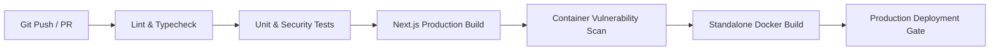

# TALENTAI CONTINUOUS INTEGRATION & DELIVERY (CI/CD) GUIDE

**Document Reference:** `DOC-OPS-008`  
**System:** TalentAI Enterprise CI/CD Pipeline  
**CI Engine:** GitHub Actions (`.github/workflows/ci.yml`)  
**Deployment Target:** Google Cloud Run / Kubernetes (Standalone Docker Container)  
**Status:** Hardened, Node.js 24 LTS Compatible

---

## 1. Pipeline Stages & Architecture

The TalentAI CI/CD pipeline enforces zero-defect production gating before any code reaches mainline branches.



### 1.1 Stage 1: Static Analysis & Type Safety
- **Node Runtime:** Node.js `24.x` (LTS >= 24.12.0).
- **Commands:**
  ```bash
  npm ci
  npx tsc --noEmit
  npm run lint
  ```
- **Exit Condition:** Zero TypeScript errors and zero ESLint warnings/errors.

### 1.2 Stage 2: Security & Regression Verification
- **Commands:**
  ```bash
  npm test
  npm audit --audit-level=moderate
  ```
- **Environment Injections:**
  - Mock Firebase emulator environment variables (`FIRESTORE_EMULATOR_HOST`, `FIREBASE_AUTH_EMULATOR_HOST`).
  - Official model identifiers (`GEMINI_MODEL_PRIMARY=gemini-2.5-flash`).
- **Exit Condition:** All 16 test suites (85 tests) must pass and zero moderate+ vulnerabilities.

### 1.3 Stage 3: Next.js Standalone Build
- **Commands:**
  ```bash
  npm run build
  ```
- **Validation:** Verifies static generation of all 42 routes and successful output of `.next/standalone`.

### 1.4 Stage 4: Docker Container Packaging
- Builds multi-stage `Dockerfile` targeting `node:24-bookworm-slim`.
- Runs `scripts/docker-smoke-test.sh` inside ephemeral CI worker.
- Publishes immutable SHA-tagged images to Google Artifact Registry / Docker Hub.

---

## 2. Secrets Management & Dependabot Compatibility

- GitHub Actions secrets are strictly segmented between environments (`Development`, `Staging`, `Production`).
- Pull requests submitted by Dependabot execute against read-only mock environments; live service account keys are never exposed to untrusted PR forks.
- Lockfiles (`package-lock.json`) are strictly version-controlled with deterministic SHA-512 integrity hashes.
