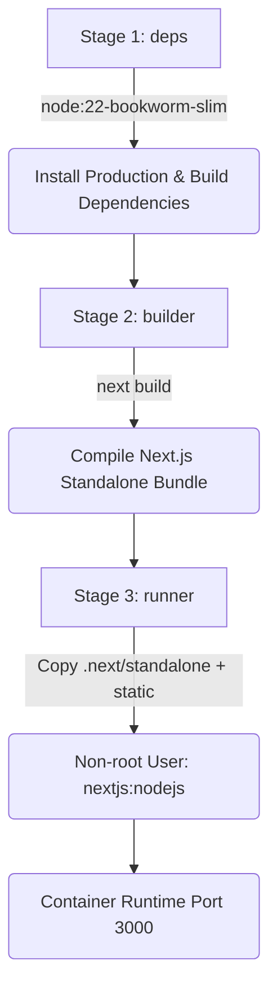

# TALENTAI ENTERPRISE DOCKER DEPLOYMENT GUIDE

**Document Reference:** `DOC-OPS-005`  
**System:** TalentAI Containerized Production Infrastructure  
**Base Image:** `node:22-bookworm-slim` (Debian Bookworm Minimal)  
**Output Strategy:** Next.js 15 Standalone Bundle (`output: 'standalone'`)  
**Compose Version:** Docker Compose v2 (`compose.yaml`)

---

## 1. Docker Build Architecture

The platform uses a secure, 3-stage multi-stage `Dockerfile` designed to minimize attack surface, optimize build caching, and enforce non-root privilege separation.



### Stage Summary

1. **`deps` Stage:**
   - Installs `libc6-compat` for Linux Alpine/Debian glibc compatibility.
   - Executes `npm ci` with clean, locked dependencies.
2. **`builder` Stage:**
   - Mounts project source code.
   - Compiles TypeScript, bundles Next.js static pages, and produces `.next/standalone`.
3. **`runner` Stage:**
   - Creates a dedicated non-root user and group (`nodejs:1001`, `nextjs:1001`).
   - Copies ONLY the minimal runtime artifacts (`.next/standalone`, `.next/static`, and `public`).
   - Sets `PORT=3000`, `HOSTNAME=0.0.0.0`, and `NODE_ENV=production`.
   - Incorporates a built-in container `HEALTHCHECK` probing `http://localhost:3000/api/health/live`.

---

## 2. Docker Compose Infrastructure (`compose.yaml`)

The production deployment consists of two tightly coupled services connected over an internal, isolated bridge network:

```yaml
services:
  app:
    build:
      context: .
      dockerfile: Dockerfile
    restart: unless-stopped
    ports:
      - "3000:3000"
    environment:
      - NODE_ENV=production
      - PORT=3000
      - HOSTNAME=0.0.0.0
      - REDIS_URL=redis://:talentai_redis_secure_pass@redis:6379
    depends_on:
      redis:
        condition: service_healthy
    networks:
      - internal-net

  redis:
    image: redis:7.4-alpine
    restart: unless-stopped
    command: ["redis-server", "--requirepass", "talentai_redis_secure_pass", "--save", "60", "1", "--loglevel", "warning"]
    volumes:
      - redis-data:/data
    networks:
      - internal-net
    healthcheck:
      test: ["CMD", "redis-cli", "-a", "talentai_redis_secure_pass", "ping"]
      interval: 10s
      timeout: 5s
      retries: 5

networks:
  internal-net:
    driver: bridge

volumes:
  redis-data:
    driver: local
```

### Security Guardrails in Compose:
- **No Public Redis Port:** The Redis port (`6379`) is NOT published to the host. It is accessible exclusively through the internal Docker bridge network `internal-net`.
- **Persistent Storage:** Redis state is stored on a named volume `redis-data` with automated snapshotting (`--save 60 1`).
- **Health-Gated Dependency:** The Next.js application waits for Redis to be fully healthy before starting.

---

## 3. Operational Commands

### 3.1 Initial Deployment
```bash
# 1. Copy and configure production secrets
cp .env.docker.example .env.production

# 2. Build and launch services in background
docker compose --env-file .env.production up -d --build

# 3. Monitor container startup logs
docker compose logs -f app
```

### 3.2 Running Smoke Tests
```bash
bash scripts/docker-smoke-test.sh
```

### 3.3 Zero-Downtime Rolling Update
```bash
docker compose build app
docker compose up -d --no-deps app
```
